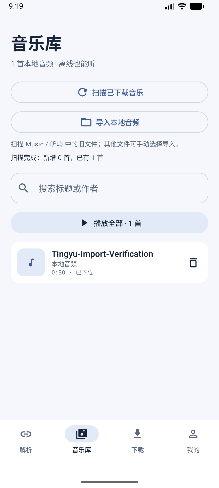

# 0.1.2 本地音乐管理验证

版本 `0.1.2`，`versionCode=3`，包名 `app.tingyu`。2026-10-29 在 macOS arm64、JDK 17、Gradle 8.11.1、Android SDK 35 下重新构建。

## 功能与代码

| 功能 | 实现 | 验证重点 |
|---|---|---|
| 找回已下载音乐 | `LocalMusicManager.scan`、`LocalMusicRules` | 仅扫描 `Music/听屿/`，忽略未完成、空文件、回收站和非音频，真实读取音轨 |
| 导入其他目录音频 | `MainActivity.localFiles`、`LocalMusicManager.importUris` | 系统多选、实际返回的读写授权、持久读取授权；不复制或转码 |
| 保留旧记录并去重 | `LibraryStore.addDiscovered` | 原数据库版本不变，兼容旧 JSON；保留旧标题、作者、URI、保存时间；媒体 URI 别名去重 |
| 本地播放与队列 | `PlaybackService.onAddMediaItems`、`TrackDataSource` | 本地编号从数据库查验；实际解码、暂停、进度跳转和下一曲；缺失本地文件不请求 B 站 |
| 确认删除 | `LocalMusicManager.delete`、`AppViewModel.performLocalDelete` | 先删除实际文件，成功后才移除记录和队列；失败或取消保留记录；系统授权绑定原操作编号 |
| 操作与恢复 | `LocalLibraryOperations`、`SavedStateHandle` | 扫描、导入、删除串行执行；导入结果不因扫描忙碌丢失；旧授权结果不能影响新的删除目标 |
| 界面 | `LibraryScreens`、`PlayerScreen` | 扫描、导入、搜索、播放、删除进度与错误重试；本地音频不显示网络下载动作 |

本地格式范围由 Android 实际媒体读取能力决定；网络下载仍只支持兼容 AAC/M4A，没有新增视频下载或任意格式转码。

## 本轮检查

- Debug 和 release 各 149 项 JVM 测试通过；两种构建模式测试相同用例，不相加。
- PC 共用网络代码 113 项 JVM 测试通过，与应用测试部分重叠，不相加。
- 29 项 Python 脚本测试通过，含 13 项发布工具测试。
- 88 项源码结构检查通过；结构检查不能替代编译和设备运行。
- Debug/release lint 无错误，分别有 23/22 条已有警告。设计审计无错误，设计引用检查有 7 条既有警告。
- Debug APK、设备测试 APK、正式 APK/AAB 和 PC 工具构建成功。
- 正式 APK/AAB 实际签名、包名、版本、非调试边界、APK 对齐、AAB 全部载荷签名均通过校验。证书与 0.1.1 一致：`ba4e5c4ba00be09d10421edac7f276f44393f52950623e64096f93c864b81911`。

设备运行：API 37 模拟器的独立临时 Android 用户中 **32 项全部通过，0 失败、0 跳过**，包括 11 项真实 Room/MediaStore 测试、1 项完整本地播放测试、1 项设置测试和 19 项界面测试。原模拟器用户的个人数据未清除。最后仅调整了本地音频删除提示文案，重新构建 debug/release，并定向复测 2 项删除界面测试通过（属于上述 32 项，不另加总）。新用户首次锁屏曾遮挡界面，解锁后重新完整执行通过。日志见 `verification-logs/local-music-20261029/`。

GitHub 签名 Secrets 尚待明确授权，云端正式构建和 Release 暂未执行；不能把工作流配置完成写成已完成云端构建。

## 系统选择器实际验收

在同一隔离用户中，通过应用按钮打开系统 `ACTION_OPEN_DOCUMENT`，从系统 Audio 分类选择专门生成的 30 秒 WAV：

1. 导入显示“新增 1 首，已有 0 首”，音乐库显示本地音频及 0:30 时长。
2. 点击扫描并在真实系统权限提示中允许音频访问，结果为“新增 0 首，已有 1 首”，没有重复条目。
3. 结束并重启应用，导入条目保留；点击播放，系统媒体会话为 `PLAYING`、无错误、缓冲到约 29.9 秒，确认持久授权后的文件仍可读取。
4. 删除确认中先选择“保留”，媒体库仍能查询到原文件；再次确认删除，媒体库查询为空，音乐库显示 0 首，播放条目移除。
5. 此音频仅用于验证，删除操作不涉及个人文件。验收后恢复原 Android 用户并移除本次临时用户。

实际界面：

真实选择器验收补充了自动化中替代系统授权边界的测试。不同厂商文件提供方、外部媒体删除系统弹窗和真机版本差异仍需验收。

## 验证边界

- 本机实体手机 `7c1213a1` 未连接，尚未完成真机覆盖升级、不同文件提供方持久授权及删除系统弹窗的完整验收。
- Room 旧记录兼容测试证明数据解码与重新打开后保留；同证书和更高版本号支持覆盖安装，但不等于已在用户手机验证升级。
- 导入测试仅在授权边界使用替身时，验证的是文件读取、媒体检查和数据库行为，不等于真实系统选择器授权通过。
- 本次未重新运行 CDN 网络探测。此前桌面 UA 成功和移动 UA 403 的结论、CDN 节点差异及 `206` 不能证明完整下载的边界保持不变，见 README。
- GitHub 正式构建须先经用户明确授权配置现有签名 Secrets；未配置时不发布未签名包或替换证书。
